# Data Quality Agent

**Author:** Kudrat Arora
**Prototype 1** of my SEL703 placement at ConnectX Consulting (Junior Software Engineer, AI & Cloud Solutions)

I built this prototype using agentic AI (Anthropic Claude) to check CSV exports, such as CRM or Salesforce customer data, for data quality problems before a migration.

You upload a CSV. An AI agent (Claude, through the Claude API with tool use) looks at a summary of the data, **decides for itself which checks to run on which columns**, runs them as tools, and returns a report with a quality score, issues ranked by severity, affected rows, examples and suggested fixes.

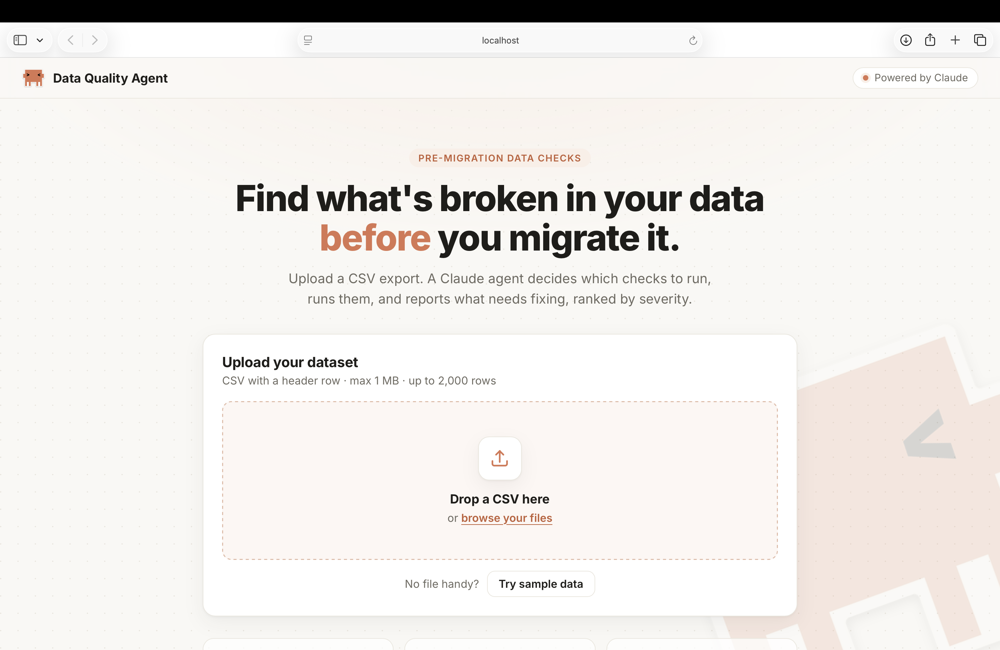

## What this prototype covers

| Requirement | Where to find it |
|---|---|
| **Working agentic AI prototype** using Anthropic Claude | [How the agent works](#how-the-agent-works), [Running on the real Claude API](#running-on-the-real-claude-api) |
| **Testing** with recorded results | [Testing](#testing): 22 unit tests, evals over three prompt versions, evals on the live site |
| **Technical documentation** | This README, plus `evidence/live-checks.md` |
| **Deployed on Cloudflare** with environment configuration, security and monitoring | [Deployment](#deployment-cloudflare-workers) |
| **Evidence of a security and a performance check** | [Security](#security) (rate limit tested on the live site) and [Monitoring](#monitoring) (CPU time finding) |

## Why I built it

Data migrations (for example into Salesforce or Snowflake) fail or need rework when the source data has duplicates, bad formats or inconsistent values. Checking this by hand is slow. I wanted to see whether an AI agent could plan and run these checks itself, while the actual counting stays in reliable, tested code.

## What it does

1. **Upload** a CSV (or click "Try sample data"). The app shows a preview of the first 5 rows.
2. **Analyse.** The agent works through the data and the page shows each check live as it finishes.
3. **Report.** A score out of 100, a verdict (for example "Needs cleanup first"), counts by severity, and a table of issues with examples and suggested fixes.
4. **Trace.** The report lists every check the agent chose to run, in order, so the decisions are transparent.
5. **Run details.** Model, turns, tokens, cost and time for each analysis.
6. **Export.** PDF report (A4), issues CSV (for Excel) or raw JSON, each with a preview before download.

| | |
|---|---|
| 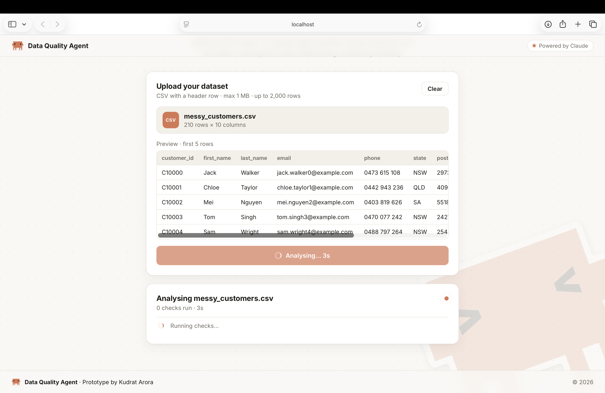 | 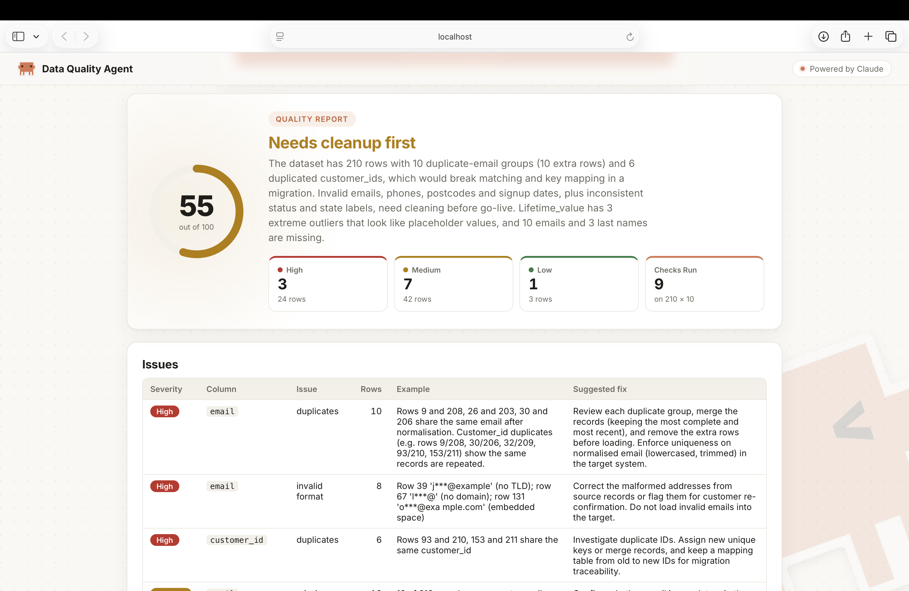 |
| 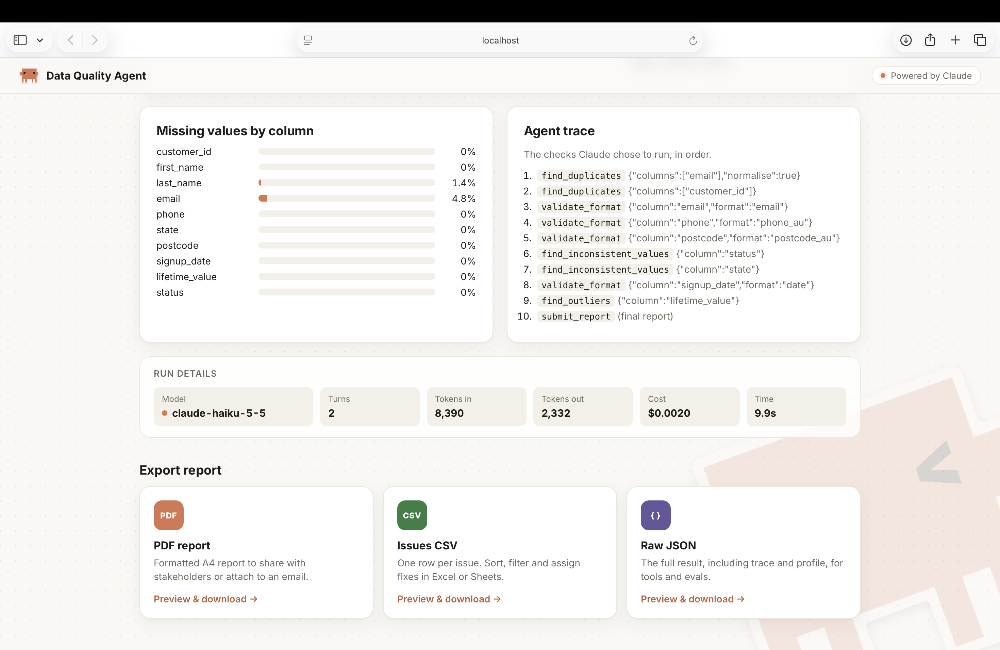 | 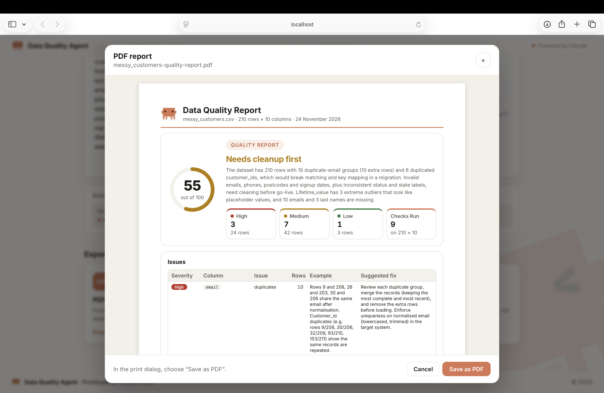 |

## How the agent works

```
Browser (React)
  │  reads the CSV with Papaparse, sends the rows as JSON
  ▼
Cloudflare Worker (worker/index.ts)
  │  checks the input, runs the agent loop (worker/agent.ts)
  │  streams progress back to the browser as it goes
  │
  ├─► Tools run here, in code (worker/tools.ts)
  │     find_duplicates · validate_format · find_inconsistent_values · find_outliers
  │
  └─► Claude API (Claude Haiku 5.5)
        sees only the data summary and tool results (masked samples)
        chooses the tools, then calls submit_report with a fixed JSON format
```

Step by step:

1. The Worker builds a **profile** of the data in code: column types, % missing, unique counts and a few masked sample values.
2. Claude gets the profile and the list of tools. It must call a tool every turn.
3. The Worker runs each tool Claude asks for and sends the results back. If Claude makes a mistake (for example a wrong column name), the error goes back to Claude so it can correct itself.
4. The loop ends when Claude calls `submit_report`. There is a limit of 8 turns; on the last turn the Worker makes Claude submit its report.
5. The report is **checked before the UI shows it**: the score is kept between 0 and 100, issues are sorted by severity, and a report with no issues always scores 100.

**Design decision:** Claude decides *what* to check, but the counting is done by normal, tested code. This means the numbers in the report come from the tools, not from the model guessing.

### Privacy by design

Claude never sees the full dataset. The tools run on the Worker and only return counts, row numbers and masked examples, for example `a***@example.com`. Names, emails and phone numbers are always masked before anything is sent to the API.

## Running on the real Claude API

The prototype runs on the real Claude API with my own API key.

| | |
|---|---|
| Model | `claude-haiku-5-5` (Claude Haiku 5.5) |
| Price | US$0.10 per million input tokens, US$0.50 per million output tokens |
| Typical analysis (210 rows) | 2 to 3 turns, about 10,000 to 16,000 tokens, about 10 seconds |
| Typical cost per analysis | **about US$0.002** |
| Total spent on all testing, evals and live testing | **about US$0.06** |

### Example run

On `messy_customers.csv` (210 rows), the agent ran 9 checks of its own choosing in 2 turns and found **all 10 planted problems with the exact row counts**. It scored the file **55/100, "Needs cleanup first"**, with 3 high, 7 medium and 1 low severity issue.

| Turns | Tokens in | Tokens out | Cost | Time |
|---|---|---|---|---|
| 2 | 8,390 | 2,332 | US$0.0020 | 9.9 s |

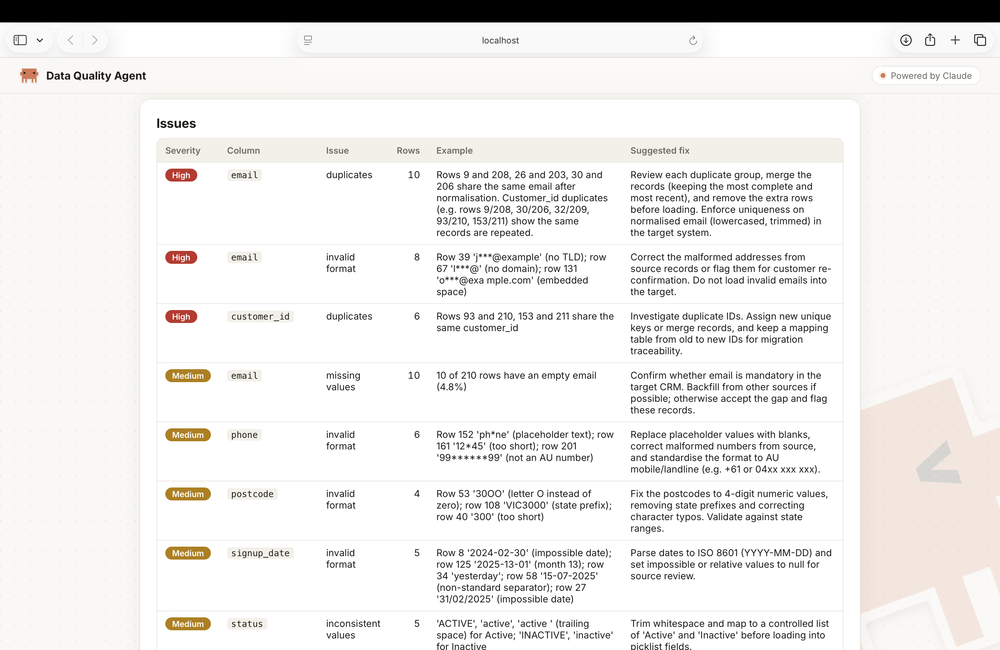

I chose Haiku because it is the cheapest current Claude model and it handled this task well (see the eval results below). I set up a prepaid account with auto-reload turned off, so the cost can never go over the credit I bought.

The API key is kept in a local `.dev.vars` file that is git-ignored. It is never in the code or the browser.

### Demo mode

When `DEMO_MODE` is set to `true`, the app runs in **demo mode**. Simple rules pick the checks instead of Claude, but the same tools run on the real data, so the numbers are still correct. A banner on the report makes this clear. I used this to build and test the interface without spending API credit. Demo mode is a deliberate setting, so the app never quietly runs without Claude when the API key is missing; it shows an error instead.

## Testing

### Unit tests (22 passing)

```bash
npm test
```

| File | What it tests |
|---|---|
| `worker/tools.test.ts` (11) | Each data quality tool on small examples: email, phone and date validation, masking, duplicates, inconsistent values, outliers |
| `worker/samples.test.ts` (6) | The tools against the answer key for the sample files, to prove the tools themselves are correct |
| `worker/agent.test.ts` (3) | The agent loop with a fake Claude: tools are called and results sent back, tool errors go back to the model instead of crashing, a clean report scores 100 |
| `worker/mock.test.ts` (2) | Demo mode finds every planted issue and reports nothing on the clean file |

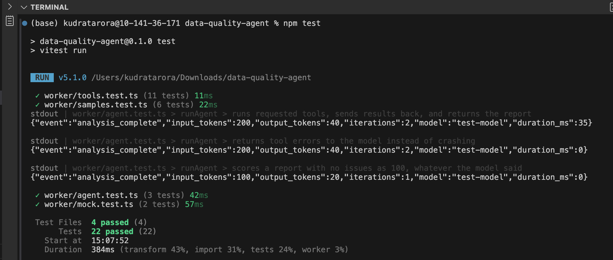

### Test data

| File | Purpose |
|---|---|
| `samples/messy_customers.csv` | 210 customer rows with **10 planted problems** (duplicates, invalid emails, phones, postcodes and dates, inconsistent states and statuses, outliers, missing values) |
| `samples/messy_customers.answer.json` | The answer key: each planted problem and its exact row count |
| `samples/clean_customers.csv` | 60 clean rows, to check the agent does not report problems that are not there |

### Evals on the real API

```bash
npm run dev                                       # terminal 1
npm run eval -- http://localhost:5173 3 v3        # terminal 2: 3 runs per file, labelled v3
```

The eval script runs the agent on both sample files and scores it against the answer key: planted issues found, exact counts, unexpected issues and false positives. Results are saved in `evals/results/`.

I improved the system prompt over three versions, running 6 evals each time (2 files × 3 runs):

| Version | Planted issues found | Exact counts | Unexpected issues | Clean file score | Cost |
|---|---|---|---|---|---|
| v1 | 30/30 | 30/30 | 4 | 93 to 97 | $0.011 |
| v2 | 30/30 | 28/30 | 1 | 97 to 98 | $0.013 |
| **v3** | **30/30** | **30/30** | **0** | **100** | **$0.011** |

What I changed and why:

- **v1 → v2.** Claude reported "first_name looks masked" in every messy run. This was caused by my own privacy masking: Claude only sees masked samples like `Ja**` and thought the data itself was masked. It also reported a vague issue affecting 0 rows. I told Claude that the masking comes from the system and is not a data problem, and that every issue needs a row count of at least 1. This removed the false alarms, but duplicate counts got worse.
- **v2 → v3.** Claude now reported duplicates on `customer_id` (6 rows) even though its own normalised email check found 10. I made the rule exact: report one duplicates issue, using the normalised email check. I also added a rule in code so a report with no issues always scores 100, because Claude kept giving the clean file 97 or 98 even when told not to.

| v1 | v3 |
|---|---|
| 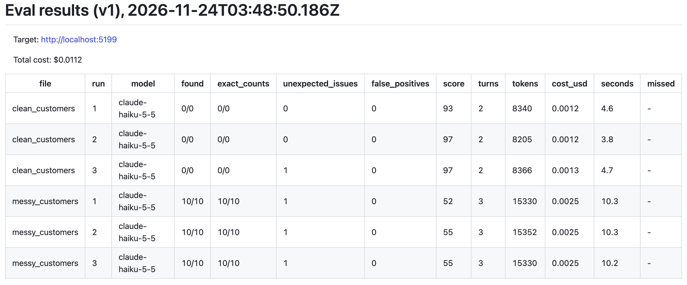 | 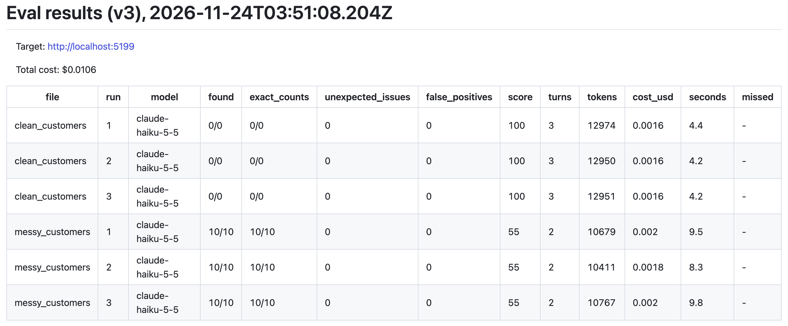 |

## Limitations

- **Duplicates can still be reported twice.** In the example run above, Claude reported the 10 duplicate emails correctly but also listed the 6 duplicate customer IDs as a separate issue, even though those 6 rows are part of the 10. The v3 prompt asks it not to do this, but it does not always follow it. My eval script did not catch this because it accepts any duplicates issue as a match, so the eval needs a stricter check.
- **CPU time on the free plan.** Full analyses used up to about 29 ms of CPU on the live site, above the free plan's documented 10 ms limit. Nothing failed in testing, but bigger files are a risk (see Monitoring).
- **Results can vary between runs.** The agent makes its own choices each time, so the checks it runs and the wording of the report can change. 3 runs per file is a small sample.
- **The prompt was tuned on my own test files.** v3 is perfect on these two files, but it may not do as well on different data.
- **Privacy and accuracy pull against each other.** Masking protects personal data but can confuse the model, as the v1 results showed.
- **Format rules are Australian.** Phone and postcode checks assume Australian formats.
- **File size is capped** at 1 MB, 2,000 rows and 50 columns to keep each request fast and the CPU time low.

## Tech stack

- **Frontend:** React, TypeScript, Vite, Papaparse
- **Backend:** Cloudflare Worker with Hono
- **Hosting:** Cloudflare Workers Free plan (`workers.dev`), Wrangler CLI, Workers rate limiting, Workers Logs
- **AI:** Claude API (`@anthropic-ai/sdk`), tool use, Claude Haiku 5.5
- **Testing:** Vitest, plus a custom eval script

## Run it locally

You need Node.js 20 or newer.

```bash
npm install
cp .dev.vars.example .dev.vars     # paste your Claude API key into .dev.vars
npm run dev                        # opens http://localhost:5173
```

No API key? Put `DEMO_MODE=true` in `.dev.vars` to use demo mode. Click **Try sample data**, then **Analyse data quality**.

## Project structure

| Path | What it is |
|---|---|
| `src/App.tsx` | Upload, preview, report and run details |
| `src/Progress.tsx` | Live progress panel |
| `src/Export.tsx` | PDF, CSV and JSON export with previews |
| `worker/index.ts` | API endpoint, input checks, progress streaming |
| `worker/agent.ts` | Agent loop and system prompt |
| `worker/tools.ts` | The data quality tools and their definitions for Claude |
| `worker/mock.ts` | Demo mode (rules instead of Claude) |
| `shared/types.ts` | Types shared by the frontend and backend |
| `samples/` | Test CSVs, answer keys and the generator script |
| `evals/` | Eval script and saved results |
| `evidence/screenshots/prototype-1-agentic-ai/` | Screenshots of the agent, reports, exports, evals and tests |
| `evidence/screenshots/cloudflare-deploy/` | Screenshots of the live deployed app on Cloudflare |
| `evidence/live-checks.md` | Raw output of the deployment and live checks |

## Deployment (Cloudflare Workers)

**Live URL:** https://data-quality-agent.data-quality-agent.workers.dev

I deployed the prototype on the **Cloudflare Workers Free plan**. One Worker serves both the React app (as static assets) and the `/api` endpoint, on a free `workers.dev` address. No payment method is linked to the account, so the free plan can never be billed: if a free limit is reached, requests stop until the limit resets.

On the live site the agent found all 10 planted problems with the exact row counts, reported duplicates once, and scored the sample file 55/100 in 2 turns for US$0.0019.

| | |
|---|---|
| 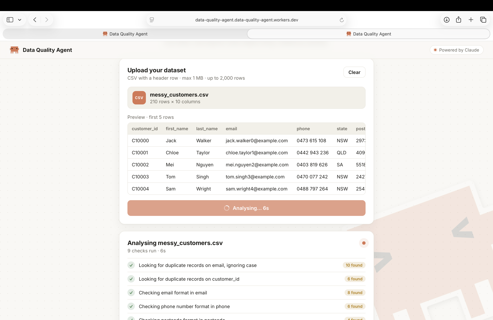 | 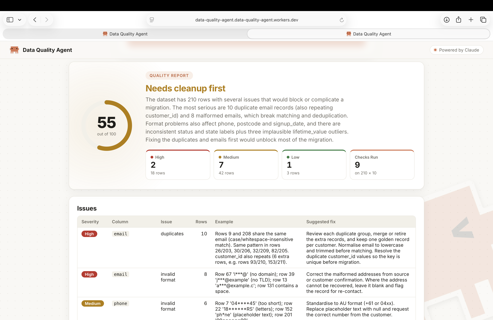 |

### How I deployed it

```bash
npx wrangler login                                   # connect the CLI to my Cloudflare account
npm run build                                        # build the React app and the Worker
npx wrangler deploy                                  # upload and publish to workers.dev
npx wrangler secret put ANTHROPIC_API_KEY            # store the Claude key as an encrypted secret
npx wrangler secret list                             # check it is there (the value is never shown)
```

Before the first deploy I checked the build output to make sure the API key was not in any file that gets uploaded or served publicly.

### Environment configuration

| Setting | Where | Value |
|---|---|---|
| `ANTHROPIC_API_KEY` | Cloudflare **secret** (encrypted) | Claude API key, expires after 30 days |
| `CLAUDE_MODEL` | `wrangler.jsonc` variable | `claude-haiku-5-5` |
| `MAX_ROWS` | `wrangler.jsonc` variable | `2000` |
| `DEMO_MODE` | `wrangler.jsonc` variable | `false` (the live site always uses Claude) |
| `ANALYZE_LIMITER` | `wrangler.jsonc` rate limit binding | 5 analyses per 60 seconds per IP |
| `observability` | `wrangler.jsonc` | Workers Logs on, 100% of requests logged |
| `preview_urls` | `wrangler.jsonc` | `false` (no extra public URLs per version) |

Locally, the same values come from `.dev.vars`, which is git-ignored.

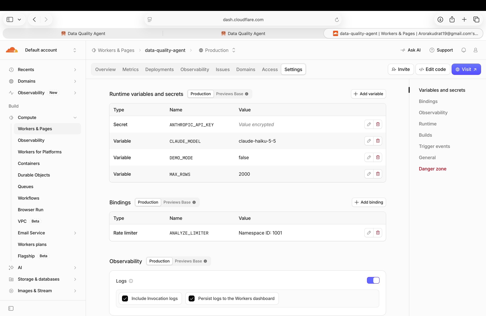

### Security

- **Secrets:** the API key is only stored as a Cloudflare secret and in a git-ignored local file. It is never in the code, the build output or the browser. The key expires after 30 days.
- **Rate limiting:** each IP address can start 5 analyses per minute. Extra requests get HTTP 429 and are logged as `rate_limited`, and the app shows "Too many analyses. Please wait a minute and try again." This stops one person from running up the Claude bill.

  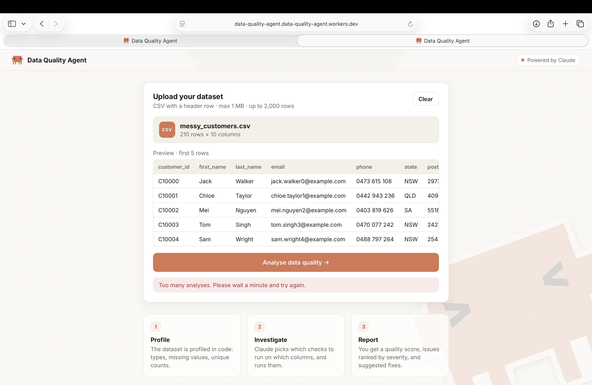

- **Spend cap:** the Claude account uses prepaid credit with auto-reload off, so the most that can ever be spent is the remaining credit.
- **Input validation:** max 1 MB, 2,000 rows and 50 columns; the JSON shape is checked before anything runs.
- **Privacy:** only masked samples and counts are sent to Claude (see Privacy by design above).
- **Smaller attack surface:** preview URLs are off, demo mode is an explicit setting, and the API is same-origin only (no CORS headers are sent, so other websites cannot call it from a browser).

### Monitoring

Workers Logs (observability) is turned on. Each analysis writes a structured log line that I can search in the Cloudflare dashboard:

```json
{"event":"analysis_complete","input_tokens":8390,"output_tokens":2332,"iterations":2,"model":"claude-haiku-5-5","duration_ms":9900}
```

Failed analyses log `analysis_failed` and blocked requests log `rate_limited`.

| `analysis_complete` in Workers Logs | `rate_limited` in Workers Logs |
|---|---|
| 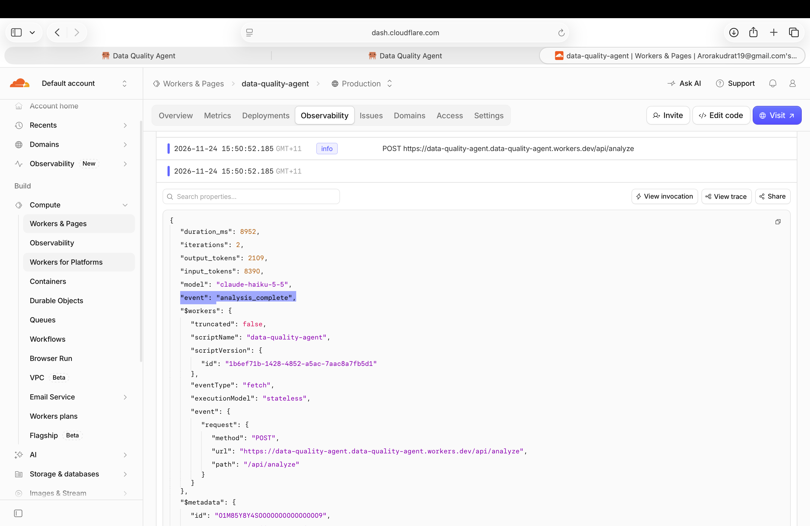 | 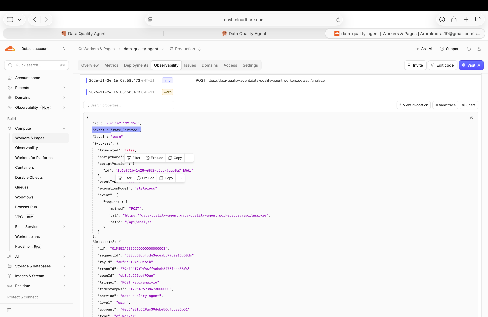 |

What the dashboard showed after testing (last 24 hours):

| Metric | Value |
|---|---|
| Invocations | 72 |
| Errors | 0 |
| Log events | 113 success, 0 errors |
| CPU time, median (P50) | 0.61 ms |
| CPU time, P90 / P99 | 23.8 ms / 29.1 ms |
| Wall time, P90 | about 10 s (mostly waiting for Claude) |
| Memory, P99 | 7 MB |

**Performance check.** Most requests use very little CPU (median 0.61 ms). Waiting for Claude counts as wall time, not CPU time. But the slowest 10% of requests, the full analyses where the Worker profiles 210 rows and runs every check, used about 24 to 29 ms of CPU. That is above the 10 ms per-request CPU limit in Cloudflare's documentation for the Workers Free plan. No request failed, but larger files could be stopped on the free plan. Options are to make the profiling cheaper, lower the row limit, or move to the paid plan, which allows much more CPU time.

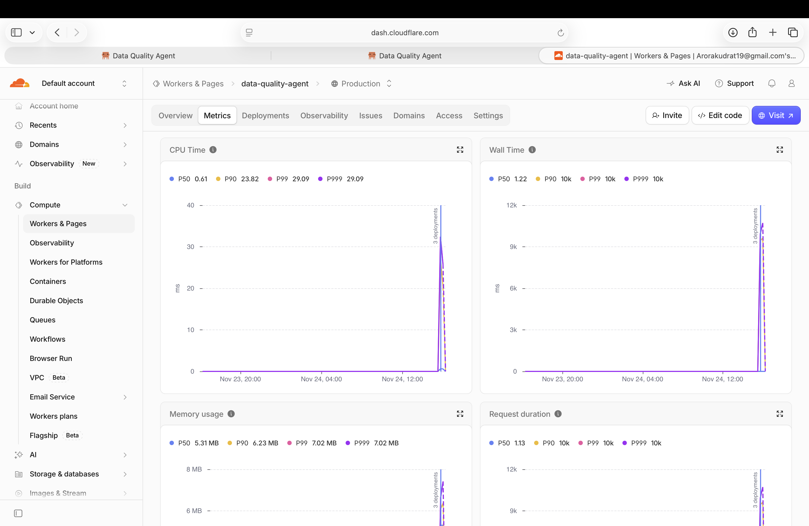

### Testing on the live site

| Check | Result |
|---|---|
| Health endpoint | `{"ok":true,"model":"claude-haiku-5-5","mock":false}` |
| Homepage | HTTP 200 in 0.28 s |
| Private files (`.dev.vars`, `wrangler.json`, source map) | Not served; the URL only returns the app page |
| Rate limit, 20 requests about 1 second apart | Requests 1 to 4 allowed, request 5 blocked, request 6 allowed, then every request from 7 to 20 blocked with HTTP 429 |
| Evals against the live URL (2 files × 3 runs, 13 s apart) | All 10 planted issues found with exact counts in 3/3 runs; clean file scored 100 in 3/3 runs; total cost US$0.0106 |

Full results: `evals/results/2026-11-24T04-51-15-334Z-live.md` and `evidence/live-checks.md`.

### What I learned from deploying

- **Rate limiting is approximate.** Cloudflare counts requests per data centre and syncs with a short delay. A quick burst of 7 requests right after the first deploy was not blocked at all, and in the later test one request slipped through after the limit. It is a good guard against abuse, but not an exact counter.
- **A new workers.dev address takes a moment.** The site returned SSL errors for about 90 seconds after the first deploy while Cloudflare issued the certificate.
- **The account email must be verified** before Cloudflare lets you create a Worker. My first deploy failed until I did this.
- **Prompt rules are not always followed.** In one live run Claude again reported a 0-row "values are masked" note, which the v3 prompt forbids. Rules that must always hold are safer in code, for example dropping any issue with 0 affected rows.
